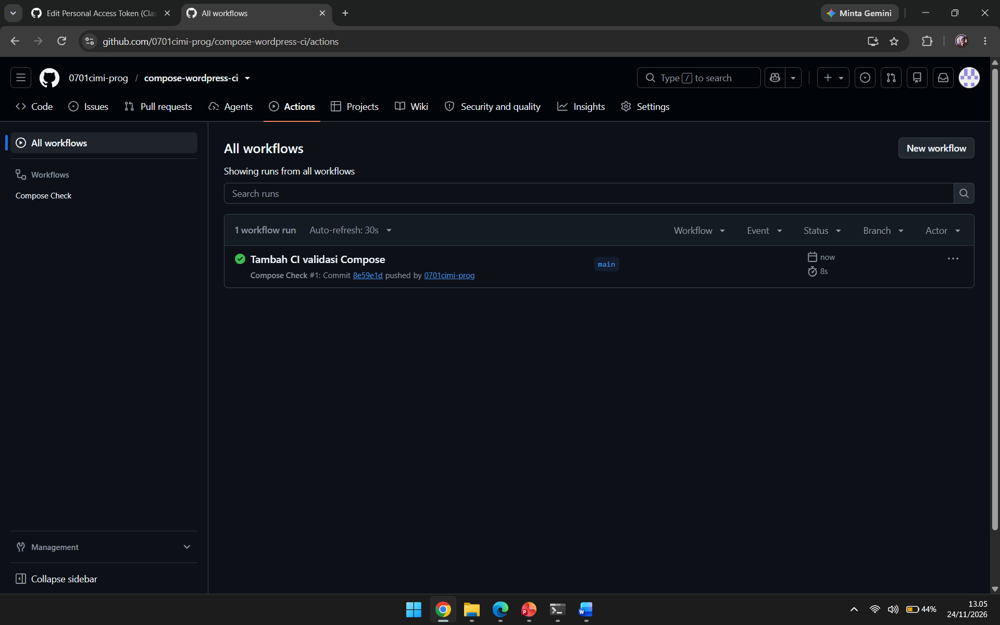
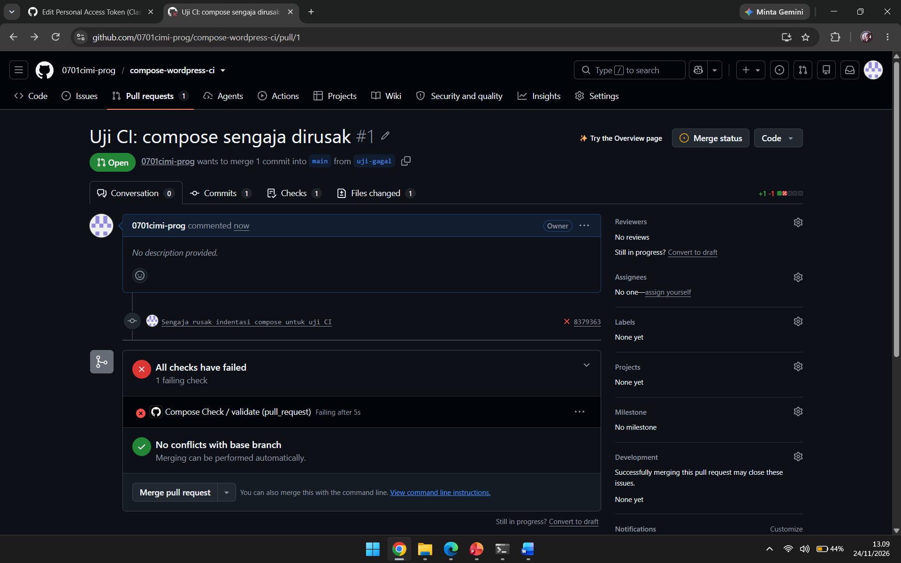
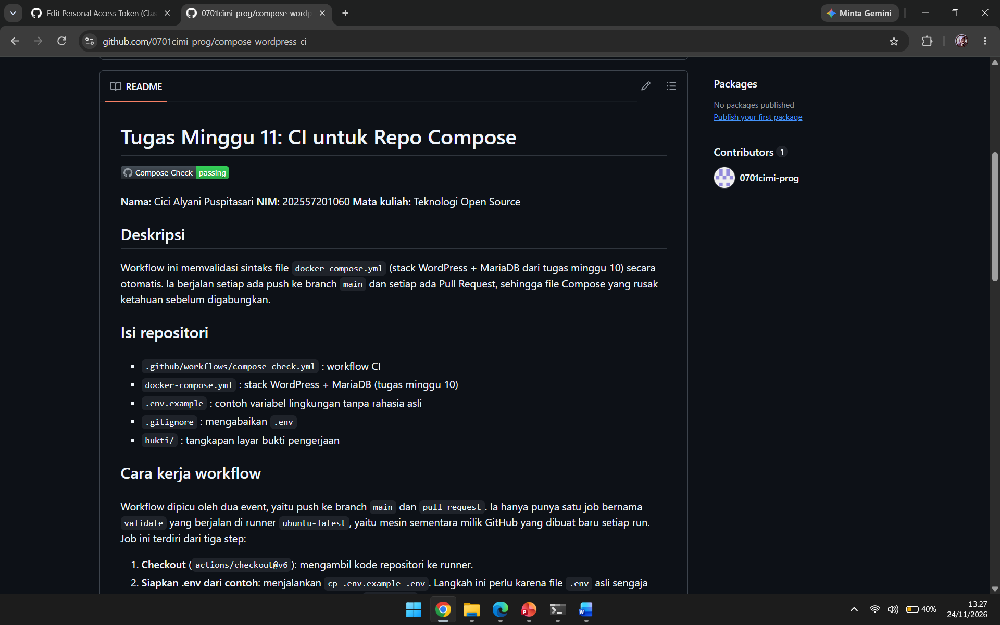
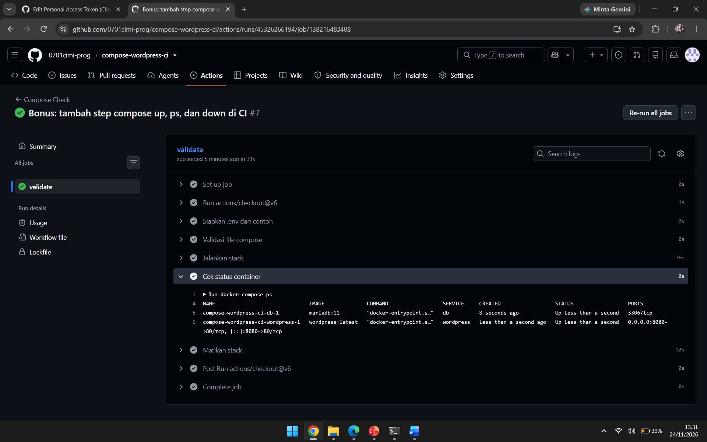

# Tugas Minggu 11: CI untuk Repo Compose

**Nama:** Cici Alyani Puspitasari
**NIM:** 202557201060
**Mata kuliah:** Teknologi Open Source

## Deskripsi
Workflow ini memvalidasi sintaks file `docker-compose.yml` (stack WordPress + MariaDB dari tugas minggu 10) secara otomatis. Ia berjalan setiap ada push ke branch `main` dan setiap ada Pull Request, sehingga file Compose yang rusak ketahuan sebelum digabungkan.

## Isi repositori
- `.github/workflows/compose-check.yml` : workflow CI
- `docker-compose.yml` : stack WordPress + MariaDB (tugas minggu 10)
- `.env.example` : contoh variabel lingkungan tanpa rahasia asli
- `.gitignore` : mengabaikan `.env`
- `bukti/` : tangkapan layar bukti pengerjaan

## Cara kerja workflow
Workflow dipicu oleh dua event, yaitu push ke branch `main` dan `pull_request`. Ia hanya punya satu job bernama `validate` yang berjalan di runner `ubuntu-latest`, yaitu mesin sementara milik GitHub yang dibuat baru setiap run. Job ini terdiri dari tiga step utama, ditambah tiga step bonus (lihat bagian Bonus di bawah):

1. **Checkout** (`actions/checkout@v6`): mengambil kode repositori ke runner.
2. **Siapkan .env dari contoh**: menjalankan `cp .env.example .env`. Langkah ini perlu karena file `.env` asli sengaja tidak ada di repo, dan tanpanya variabel seperti `${DB_NAME}` akan kosong.
3. **Validasi file compose**: menjalankan `docker compose config -q`, yang hanya memeriksa sintaks file Compose tanpa menjalankan container. Jika file tidak valid, perintah ini gagal dan check berwarna merah.

## Bukti
1. Run hijau di tab Actions
   
2. Pull Request dengan check gagal (merah)
   
3. Badge status di README
   

Tautan Pull Request (sudah hijau dan di-merge): https://github.com/0701cimi-prog/compose-wordpress-ci/pull/1

## Kendala dan cara mengatasinya
**Kendala 1: check merah pada PR uji-gagal (disengaja).**
Pada branch `uji-gagal`, indentasi baris `image: mariadb:11` pada service `db` sengaja dikurangi satu spasi. CI menampilkan pesan error berikut:
yaml: line 4, column 12: mapping values are not allowed in this context
Error: Process completed with exit code 1.

Pesan ini menunjuk ke baris sesudah baris yang salah, karena parser YAML baru bingung ketika membaca baris berikutnya. Saya memperbaikinya dengan mengembalikan indentasi menjadi 4 spasi, lalu push ke branch yang sama. Setelah itu check pada PR berubah hijau dan PR di-merge ke `main`.

**Kendala 2: file screenshot tidak ditemukan saat disalin dari WSL.**
Perintah `cp` dari folder Downloads gagal dengan pesan `No such file or directory`. Ternyata screenshot tersimpan di folder OneDrive (`/mnt/c/Users/cicia/OneDrive/Pictures/Screenshots/`). Setelah memakai path yang benar (dengan tanda kutip), file berhasil disalin ke folder `bukti/`.

## Refleksi singkat
Dengan CI, kesalahan pada file Compose ketahuan beberapa menit setelah push, bukan setelah saya menjalankan stack-nya dan baru sadar ada yang rusak. Hasil hijau atau merah di Pull Request juga membuat saya yakin perubahan aman sebelum digabungkan ke `main`. Pengalaman ini menunjukkan bahwa validasi otomatis menghemat waktu dan mengurangi kesalahan karena lupa memeriksa secara manual.

## Bonus: uji jalan stack di CI
Selain validasi sintaks, workflow ditambah tiga step yang benar-benar menjalankan stack di runner:

4. **Jalankan stack**: `docker compose up -d` menjalankan WordPress dan MariaDB di latar belakang.
5. **Cek status container**: `docker compose ps` menampilkan status kedua container di log.
6. **Matikan stack**: `docker compose down -v` mematikan dan menghapus container beserta volume. Step ini memakai `if: always()` sehingga tetap berjalan walaupun step sebelumnya gagal.

Perubahan ini dikerjakan lewat branch `bonus-compose-up` dan Pull Request terpisah supaya `main` tetap aman: https://github.com/0701cimi-prog/compose-wordpress-ci/pull/2

